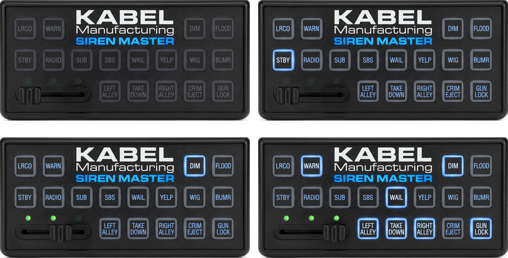
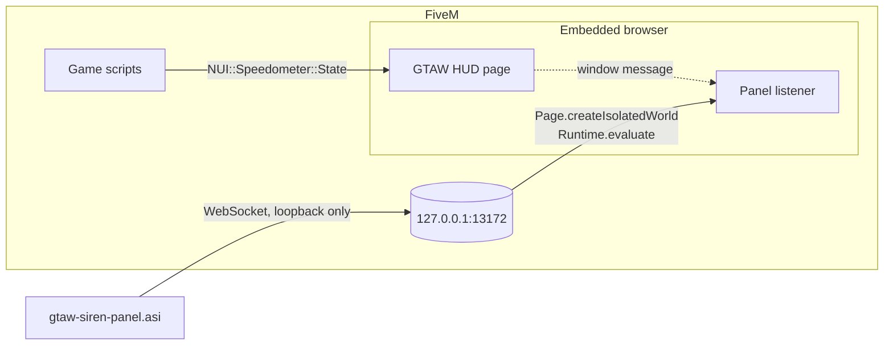
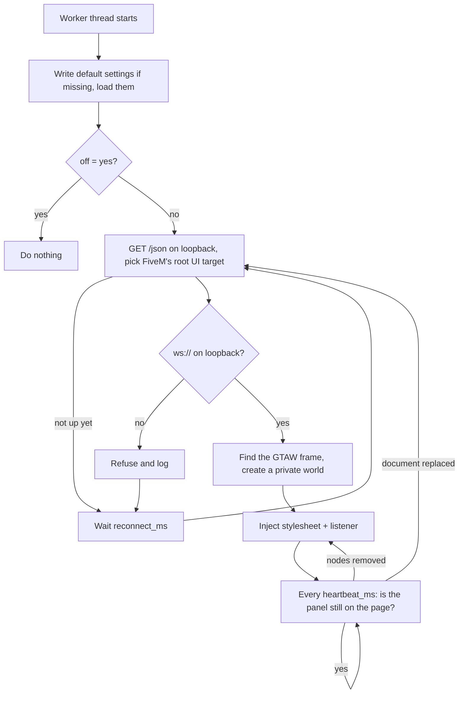
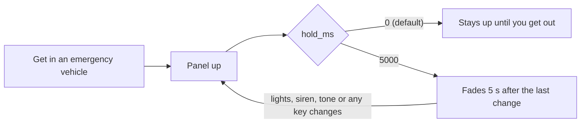

<h1 align="center">
  GTA World · Siren Master
</h1>

<p align="center">
  <a href="LICENSE"></a>
  <a href="CHANGELOG.md"></a>
  <a href="#the-panel"></a>
  <a href="https://fivem.net/"></a>
  <a href="build.bat"></a>
</p>

<p align="center">
  A <strong>Kabel Siren Master</strong> control head for GTA World's emergency vehicles — on top of the HUD you already have.
</p>

> In a patrol car, the siren controller sits right above your speedometer: the slide knob and its LEDs follow the lights, the tone keys follow the siren, and LRCO, WARN, DIM, TAKE DOWN, the alleys and GUN LOCK follow the handbrake, hazards, headlights, high beams, turn signals and door locks. **The game's HUD is left exactly as it is** — nothing is hidden, moved or restyled.

> [**ⓘ**](#security) **Security:** the plugin only *listens*. It hooks nothing, patches nothing, calls no game native, never sends a message and opens exactly one socket — to `127.0.0.1`.

<p align="center">
  <a href="docs/screenshots/panel.png"></a>
</p>

---

## Install

1. Download `gtaw-siren-panel.asi` from the [latest release](https://github.com/MatiDeZeta/gtaw-siren-panel/releases/latest), or [build it yourself](#building).
2. Drop it into your FiveM `plugins` folder:
   ```
   %LOCALAPPDATA%\FiveM\FiveM.app\plugins\
   ```
   A portable install uses its own `FiveM.app\plugins` instead — `D:\FiveM\FiveM.app\plugins`, say.
3. Launch FiveM, join GTA World and get in an emergency vehicle. The panel appears above the speedometer.

On first run the plugin writes `gtaw-siren-panel.settings.txt` next to itself — every option listed, explained and set to its default — and `gtaw-siren-panel.log`, recording every connection attempt, install and failure. `gtaw-siren-panel.layout.txt` appears once the panel has been placed with [`/hudlayout`](#placing-it).

It works with the game's HUD and with [gtaw-oldhud](https://github.com/MatiDeZeta/gtaw-oldhud) alike.

<details>
<summary><strong>More information</strong></summary>

### Features

1. **Only the panel** — one element and one stylesheet scoped to it; the game's HUD is untouched
2. **Sits on the speedometer** — right edges lined up, just above it, wherever the game's layout put it
3. **Always up, or a pop-up** — stays up the whole drive by default; `hold_ms = 5000` shows it on every change and fades it five seconds later
4. **Every key means something** — the knob, LEDs and tone keys follow the lights and siren, and the other keys follow the vehicle, remappable with one setting
5. **Placed with `/hudlayout`** — dragged, scaled and hidden inside the game's own layout editor
6. **Listens only** — no hooks, no natives, no memory access, no outbound connection, no update check
7. **No dependencies** — WinHTTP and a 300-line JSON reader, fuzzed under ASan and UBSan
8. **Reproducible builds**, checked by building twice in CI

### How it works

GTA World's HUD is a web page that FiveM renders in an embedded browser. The game sends it `NUI::Speedometer::State` messages, which carry the ELS state along with the engine, lights, signals, handbrake, door locks and cruise control.

The plugin attaches to that browser through the local debugging endpoint FiveM itself opens on `127.0.0.1:13172`, finds the GTAW frame, creates a **private execution context** in it, and installs a stylesheet and one message listener there. The listener reads the messages the page is already receiving and draws the panel from them.



A private context shares the page's DOM but not its variables, so nothing the plugin defines can collide with, or be reached by, the page's own scripts.

### Lifecycle



</details>

---

## The panel

The game reports three ELS states and, with the siren on, which tone it is sounding. The same speedometer state carries the engine, headlights, high beams, turn signals, handbrake, door locks and cruise control. This is how each lands on the panel:

| The game says | The panel shows |
|---|---|
| ELS off | `STBY` lit, knob at **OFF**, no LEDs |
| Lights | knob at **2**, two LEDs (`lights_stage`) |
| Lights and siren | knob at **3**, three LEDs |
| Siren tone 1 / 2 / 3 / 4 / 5 / 6 | `WAIL` / `YELP` / `SBS` / `WIG` / `BUMR` / `SUB` lit (`tone_keys`) |
| Engine running / off | key legends backlit blue / dark (`backlight`) |
| Handbrake | `LRCO` lit |
| Hazards (both signals) | `WARN` lit |
| Headlights (low or high) | `DIM` lit |
| High beams | `TAKE DOWN` lit |
| Left / right signal | `LEFT ALLEY` / `RIGHT ALLEY` lit |
| Doors locked — the speedometer's lock icon | `GUN LOCK` lit |

The vehicle keys are a mapping, not a fact about the car, so `keys` changes it: any key but `STBY` — `lrco`, `warn`, `dim`, `flood`, `radio`, `sub`, `sbs`, `wail`, `yelp`, `wig`, `bumr`, `leftalley`, `takedown`, `rightalley`, `crimeject`, `gunlock` — can follow `cruise`, `handbrake`, `headlights`, `highbeams`, `leftsignal`, `rightsignal`, `hazards`, `locked`, `engine` or `none`. `FLOOD`, `RADIO` and `CRIM EJECT` follow nothing by default. The panel only shows; it never presses anything, and the lights and siren are still worked with the game's own keys.



The panel is twenty-six PNG layers in [`assets/kabel/`](assets/kabel/), each a picture of the whole panel with only its own part drawn in, stacked full width from the top-left corner. All of them are cut out of one photograph, [`art/siren-master.jpg`](art/siren-master.jpg), by [`tools/make_panel.py`](tools/make_panel.py): the light is separated from the faceplate's black and dimmed for the unpowered keys, turned blue for the backlight and the lit keys, and kept for the LEDs; the knob is lifted out and set at each stop, with the slot under it rebuilt from its own mirror image. Each key's light is taken only from the pixels joined to that key, with a soft edge, so no key carries a box round it. Regenerating them needs Pillow and numpy; nothing else does. They are compiled into the `.asi` as ordinary `RCDATA` resources and encoded for the page only when it is installed, and [`tools/check_assets.py`](tools/check_assets.py) fails the tests unless every one is a well-formed PNG carrying pixels and nothing else.

---

## Settings

Everything lives in `gtaw-siren-panel.settings.txt`, written next to the plugin on first run:

| Setting | Default | What it does |
|---|---|---|
| `off` | `no` | Disables the plugin without removing the file |
| `hold_ms` | `0` | `0` keeps the panel up while you are in the vehicle; `5000` shows it on every change and fades it five seconds later |
| `lights_stage` | `2` | Where the knob sits for lights without the siren: `1`, `2` or `3` |
| `tone_keys` | `wail,yelp,sbs,wig,bumr,sub` | The key lit for each siren tone, tone 1 first: `sub`, `sbs`, `wail`, `yelp`, `wig`, `bumr` or `none` |
| `keys` | `lrco:handbrake,warn:hazards,dim:headlights,…,gunlock:locked` | Which vehicle state lights which key — see [the panel](#the-panel) |
| `backlight` | `engine` | `engine`: legends backlit only while the engine runs; `always` |
| `alpha` | `1.0` | How opaque the panel is, `0.05` to `1` |
| `port` | `13172` | FiveM's local debugging port |
| `reconnect_ms`, `heartbeat_ms` | `2000`, `4000` | Retry and liveness intervals |

### Placing it

By default the panel's right edge lines up with the speedometer's and it sits just above it, following the speedometer wherever the game's layout put it. `/hudlayout` moves it from there: while the game's editor is open the panel takes the same dashed outline as the game's widgets, drags with the mouse, scales with the wheel (snapping to the editor's grid when Snap is on) and hides with its cross. It is shown while the editor is open even on foot, so it can be placed.

**Save** and **Escape** keep what was done, **Cancel** puts it back, and the editor's **Reset** puts the panel back on the speedometer. The result is kept in `gtaw-siren-panel.layout.txt` next to the plugin, as fractions of the screen so it holds at any resolution; the plugin never sends anything, so the game's own saved layout is not touched.

---

## Building

**Windows, MSVC** — the intended path. Needs the Visual Studio Build Tools with the *Desktop development with C++* workload:

```bat
build.bat
```

That is the whole of it. Nothing to restore first; it produces `gtaw-siren-panel.asi`.

**Linux, MinGW-w64** — for producing a binary without a Windows machine:

```sh
MINGW_BIN=/path/to/mingw/bin ./build-mingw.sh     # or just have mingw-w64 on PATH
```

| | `build.bat` (MSVC) | `build-mingw.sh` (MinGW) |
|---|---|---|
| C runtime | UCRT, static (`/MT`) | `msvcrt.dll`, which ships with Windows |
| Control Flow Guard | yes (`/guard:cf`) | **no** — GCC has no equivalent |
| Stack cookies | `/GS` | `-fstack-protector-strong` |
| NX, ASLR, high-entropy ASLR | yes | yes |
| Reproducible | `/Brepro` | `--no-insert-timestamp` |

Control Flow Guard is the one real difference, so prefer the MSVC build if you can.

Afterwards, check the result is something FiveM will accept:

```sh
tests/verify_asi.py gtaw-siren-panel.asi
```

It confirms a native 64-bit DLL with no CLR header, no exports, the hardening bits set, and — the part that matters most — all 18 `FX_ASI_BUILD` stamps. If the stamp for the running game build is missing, FiveM declines to load the plugin *silently*, which looks exactly like "it does nothing".

> The plugin **cannot** be written in C#: FiveM's ASI loader refuses managed DLLs outright.

### Tests

```sh
tests/run.sh                          # needs g++ and node; downloads nothing
FUZZ_ITERATIONS=2000000 tests/run.sh  # fuzz the JSON reader for longer
```

Every source file is typechecked; the JSON reader is unit-tested and fuzzed under AddressSanitizer and UndefinedBehaviorSanitizer; the loopback guard, the settings file, the layout file and the startup log each have a suite; the injected script is driven against a stub DOM; and the *exact* expression the plugin injects — generated by the real C++ — is checked for scoping, for leaving the game's HUD untouched, for every panel layer, and for the absence of any URL that is not a `data:` URI. `tests/stub/` stands in for the Win32 and WinHTTP surfaces using the documented signatures, so a mismatch there is a mismatch on MSVC too.

---

## Troubleshooting

| Symptom | Fix |
|---|---|
| Nothing appears | Read `gtaw-siren-panel.log` next to the `.asi`. A fresh log starts with `----- gtaw-siren-panel starting -----`; if it does not, the plugin was never loaded |
| No panel in a patrol car | It only shows in a vehicle the game reports ELS for. With `hold_ms` set it has faded; change the lights or siren to bring it up |
| The panel is too big, too small, or in the way | Open `/hudlayout`, drag it and scroll over it |
| The panel is drawn twice | `gtaw-oldhud-leo.asi` is in the same folder and draws the same panel — keep one |
| No log file at all | The `.asi` is in the wrong folder, or the server runs `sv_purelevel 2`, which stops FiveM enumerating plugins |
| Log says `Waiting: …` forever | The HUD page is not up yet, or another debugger client holds the target — see below |
| FiveM stops during startup | Remove the `.asi` to confirm; keep the log and the crash dump |
| Warnings about unknown keys in the log | A setting was misspelt, or the file is from another plugin — delete it once and it is regenerated |
| Antivirus flags the file | See [docs/antivirus.md](docs/antivirus.md) |

**Running alongside the log parser.** GTAW Log Parser attaches to the same endpoint to capture chat. Each attaches over its own socket and neither can see the other's traffic, so in principle they coexist; recent Chromium allows several debugger clients on one target, older builds allowed one. If chat capture and the panel stop working when both run, that is the likely cause and the log will show the failed attach.

Whether a given server permits a plugin in that folder is the server's decision, and this project does not speak for GTA World.

---

<a id="security"></a>

## Security

The plugin is a **passive listener**, and every claim below is readable in the source.

- **Loopback only.** The debugger hands back the WebSocket URL to connect to. That is the one value the plugin does not choose for itself, so it is checked rather than trusted: anything not `ws://` on a loopback address is refused. `tests/wsurl_test.cpp` covers the ways that check could be fooled — `127.0.0.1.evil.com`, `user@evil.com`, `127.0.0.1:13172@evil.com`, and so on. Every socket is opened with `WINHTTP_ACCESS_TYPE_NO_PROXY`, so a system proxy cannot see or redirect it.
- **No outbound connection, ever.** Nothing is downloaded, at build time or at run time; there is no update check; the test suite fails if anything that gets injected contains a URL that is not a `data:` URI.
- **Nothing is hooked, patched or read from memory.** It calls no game native, so it does not depend on `sv_scriptHookAllowed`. It never sends a message and never invokes an interface callback.
- **One parser for untrusted bytes.** The JSON reader is ~300 lines written for this, capped at 64 levels of nesting and 16 MB, and fuzzed under ASan and UBSan. Numbers that overflow are refused, and every protocol number becomes an `int` through a range-checked accessor.
- **Settings cannot inject.** Every value is checked against a fixed list or a numeric range before it reaches the page; one bad entry in a key list refuses the whole list.
- **Images are checked before they are compiled in.** Every panel layer must be a well-formed PNG with matching chunk checksums and nothing after its end; text and other metadata chunks are dropped. They reach the page as `data:` URIs inside the stylesheet, never as a file or a URL.
- **Hardened, reproducible binary.** `/GS /sdl /guard:cf /DYNAMICBASE /NXCOMPAT /HIGHENTROPYVA /Brepro`, with the header dated to the commit it was built from ([`tools/set_pe_time.py`](tools/set_pe_time.py)). CI builds twice and compares the hashes, and the release notes carry the SHA-256 of the file.

Attaching to a browser's debugging port is also something infostealers do, so expect generic machine-learning antivirus detections more than an ordinary mod gets. [docs/antivirus.md](docs/antivirus.md) explains what the detection names mean and what to check instead of counting engines.

---

<sub>

MIT © [MatiDeZeta](https://github.com/MatiDeZeta) · the panel from the LEO edition of [gtaw-oldhud](https://github.com/MatiDeZeta/gtaw-oldhud) · Not affiliated with GTA World or Cfx.re.

</sub>
